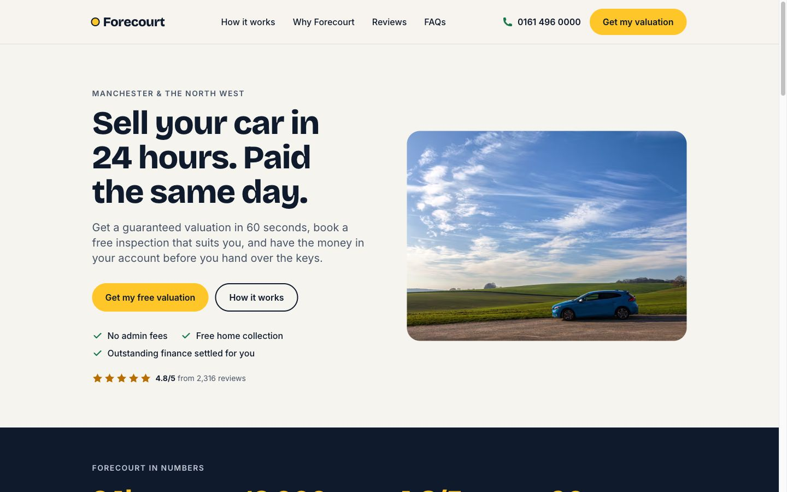
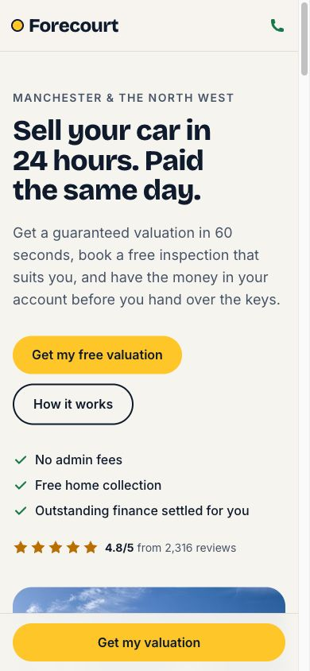
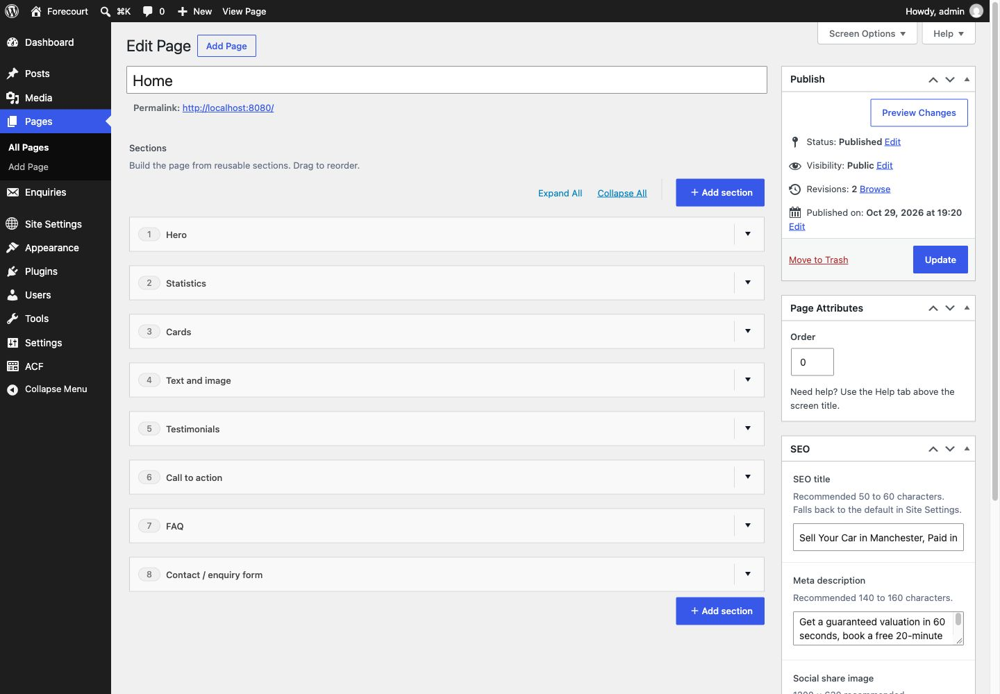

# Forecourt: headless WordPress + Next.js

A one-page lead generation site for **Forecourt**, a fictional Manchester car-buying service ("Sell your car in 24 hours"). WordPress and ACF Flexible Content manage the page; a Next.js frontend fetches it over a custom REST endpoint and renders each section as a React component.

I framed it as the landing page I'd build for an agency client running paid traffic: one conversion goal (get a valuation), fast on mobile, and fully editable by a content editor without a developer.

| Desktop | Mobile | WordPress editor |
| --- | --- | --- |
|  |  |  |

All eight sections from the brief are built: hero, statistics, services/cards ("How it works"), text and image, testimonials, call to action, FAQ and contact/enquiry form.

---

## Quick start

You need **Docker** and **Node 22**. Everything WordPress-related runs inside containers, so no local PHP or WP-CLI is required.

```bash
make setup                    # starts WordPress, installs plugins, seeds the page and creates frontend/.env.local
cd frontend && npm install
npm run dev                   # http://localhost:3000
```

No `make`? The same thing by hand:

```bash
cp .env.example .env          # then set FORECOURT_SHARED_SECRET to any long random string
docker compose up -d
docker compose run --rm wpcli bash /scripts/setup.sh
# create frontend/.env.local from the block below, then:
cd frontend && npm install && npm run dev
```

```dotenv
WORDPRESS_URL=http://localhost:8080
SITE_URL=http://localhost:3000
CONTENT_SOURCE=wordpress
FORECOURT_SHARED_SECRET=<same value as in .env>
```

| What | Where |
| --- | --- |
| Site | http://localhost:3000 |
| WordPress admin | http://localhost:8080/wp-admin (`admin` / `password`) |
| Page API | http://localhost:8080/wp-json/forecourt/v1/page/home |
| Mailpit (enquiry emails) | http://localhost:8025 |

Setup is safe to run again, but it resets the home page to the seed content. `make reset` wipes the database for a fresh start.

**ACF Pro or free.** Flexible Content needs ACF Pro. If you drop an ACF Pro zip into `wordpress/plugins-dropin/`, setup installs it. Otherwise it installs [Secure Custom Fields](https://wordpress.org/plugins/secure-custom-fields/), the free WordPress.org fork of ACF that includes Flexible Content, Repeaters and Options Pages and reads the same field group JSON. No licensed files or keys are in this repo. I tested both paths.

**Without WordPress at all.** `CONTENT_SOURCE=fixtures npm run dev` renders the page from bundled sample JSON. CI uses this, as does the Docker image: after `make env` (or copying `.env.example` to `.env`), `docker compose --profile frontend up --build frontend` serves a production build of the frontend on :3000.

**A quick tour of wp-admin.** Log in at http://localhost:8080/wp-admin with username `admin` and password `password`. Setup creates this account; change `WP_ADMIN_USER` and `WP_ADMIN_PASSWORD` in `.env` before running it if you'd like different ones. These are local development defaults only. Visiting http://localhost:8080 itself redirects to the Next.js site on purpose, because in a headless setup WordPress has no public front end.

| Menu item | What's there |
| --- | --- |
| **Pages → Home** | The page builder: the "Sections" Flexible Content field with all eight layouts (add, remove, drag to reorder), plus the **SEO** box in the sidebar |
| **Site Settings** | Global content: site name, phone, email, address, header button, rating, footer text and default SEO |
| **Enquiries** | Form submissions, stored as a private post type |
| **ACF → Field Groups** (**SCF** with the free plugin) | The three field groups: Page Sections, SEO and Site Settings. Setup imports them from the JSON files in the repo, and any change saved here writes back to those files |

**Try the editor flow.** Edit any section in wp-admin and click Update, then reload the site. The change is there straight away (see [Revalidation](#caching-and-revalidation)). Submit the form and the enquiry appears under **Enquiries** in wp-admin, with a notification email in Mailpit.

---

## Approach

I started from what a real agency build needs rather than the minimum the brief asks for, then cut back to what I could finish properly in the time. I planned in this order:

1. **The editor's experience.** One "Sections" Flexible Content field with eight layouts, clear labels and instructions, a Site Settings options page for global content (phone, rating, footer, default SEO), and a per-page SEO group. The block editor is switched off for pages, so editors see only the section builder.
2. **A stable data contract.** WordPress doesn't expose raw ACF data. A small custom endpoint returns clean, predictable JSON: camelCase keys, images as `{ url, alt, width, height }`, empty fields as `null` or `[]`. The frontend never needs to know how ACF stores things.
3. **Components that mirror layouts.** Each ACF layout maps to one React component through a registry, so adding a section means one ACF layout, one normaliser case, one schema and one component.
4. **Fail soft.** Missing fields, a broken section or WordPress being down should degrade the page, not break it.
5. **Quality you can check.** Types, validation at the API boundary, tests, CI, accessibility, performance and SEO, all verifiable from the repo.

I set a cut order up front in case time ran short: browser end-to-end tests went first (they were cut; see [Testing](#testing-and-quality)), and Flexible Content, the eight sections, empty-field handling and this README were never on it.

## Assumptions

- **Single page.** The brief asks for a one-page site, so routing is just `/`. The endpoint and caching are already keyed by slug, so more pages would need only a dynamic route.
- **The reviewer has Docker and Node 22.** Nothing else needs installing on the host.
- **Editors are non-technical.** Hence instructions on fields, sensible defaults and validation in WordPress (for example, required headings on the hero and call to action).
- **A fictional business is fine.** The content, figures and reviews are illustrative, and the footer says so.
- **Enquiries stay in WordPress.** A real client would likely push leads to a CRM. Here they are stored as a private post type with an email notification, which is the usual agency starting point.
- **Hosting is Vercel (or any Node host) plus managed WordPress.** See [Deployment notes](#deployment-notes).

---

## Architecture

```
                     ┌──────────────────────────── WordPress (Docker) ───────────────────────────┐
  Editor ──wp-admin──▶  ACF Flexible Content + options + SEO fields                              │
                     │  mu-plugin forecourt-core                                                   │
                     │   GET  /wp-json/forecourt/v1/page/{slug}   normalised JSON                  │
                     │   GET  /wp-json/forecourt/v1/settings                                       │
                     │   POST /wp-json/forecourt/v1/enquiries     secret header, validate, store   │
                     │   on save ──▶ POST {next}/api/revalidate    secret header, cache tags       │
                     └───────────────▲──────────────────────────────────────┬──────────────────────┘
                                     │ server-to-server only                │
                     ┌───────────────┴──────── Next.js 16 (App Router) ─────▼──────────────────────┐
  Visitor ─────────▶ │  lib/wordpress.ts  fetch + Zod validation + cached by tag                    │
                     │  SectionRenderer   layout name ──▶ component (registry)                      │
                     │  Server Action     enquiry form ──▶ WordPress                                │
                     └──────────────────────────────────────────────────────────────────────────────┘
```

**Request flow.** The home page is prerendered and cached. On a cache miss, `lib/wordpress.ts` (the only module that talks to WordPress) fetches the page and settings, validates them with Zod, and caches the result under the tags `page:home` and `settings`. `SectionRenderer` looks up each section's `layout` in a registry and renders the matching component. The browser never calls WordPress, so WordPress needs no CORS rules and can sit behind a firewall.

**Data contract.** One section from `GET /page/home`:

```json
{
  "layout": "text_image",
  "id": "text_image-3",
  "anchor": "why-forecourt",
  "heading": "A fair price, without the hassle",
  "body": "<p>Selling privately means time-wasters...</p>",
  "image": { "url": ".../city-car.jpg", "alt": "Small red car...", "width": 1600, "height": 1066 },
  "imagePosition": "left",
  "cta": { "label": "Get my free valuation", "url": "#contact", "newTab": false }
}
```

**Folder map**

```
docker-compose.yml          WordPress, MariaDB, WP-CLI, Mailpit (+ optional frontend profile)
Makefile                    make setup / up / down / reset
wordpress/
  mu-plugins/forecourt-core/
    acf-json/               exported ACF field groups (Page Sections, SEO, Site Settings)
    src/acf.php             JSON load/save path, options page, block editor off for pages
    src/normalise.php       ACF rows ➜ clean JSON, one case per layout
    src/rest.php            GET /page/{slug}, GET /settings
    src/enquiries.php       private "enquiry" post type, POST /enquiries
    src/revalidate.php      on save, tell Next.js which cache tags changed
    src/headless.php        redirect front end to Next.js, noindex, hide users endpoint, mail
  themes/forecourt-headless/  near-empty theme (WordPress needs one active)
  scripts/                  setup.sh, ACF field group sync and the seed script, run inside the wpcli container
  seed/                     page content as JSON + two CC0 images
frontend/src/
  lib/                      wordpress.ts (client), schemas.ts (Zod), seo.ts, env.ts, enquiry-schema.ts
  components/sections/      one component per layout + SectionRenderer + registry
  components/ui|layout|forms  shared primitives, header/footer/sticky CTA, enquiry form
  actions/enquiry.ts        Server Action posting enquiries to WordPress
  app/                      page, layout, error and not-found states, sitemap, robots, /api/revalidate
```

**Exported ACF field groups** are the JSON files in `wordpress/mu-plugins/forecourt-core/acf-json/`. ACF loads and saves them there automatically, so field changes made in wp-admin show up as a git diff.

### Handling missing and empty fields

This happens at three layers, and each layer has its own job:

1. **WordPress normaliser.** Empty strings become `null`, unset images become `null`, links WordPress can't make safe (an unsupported protocol, say) become `null`, and repeater rows missing their required field (a testimonial without a quote, say) are dropped. Unknown layouts pass through untouched.
2. **Zod schemas.** Each section is validated on its own. A section that fails is dropped with a server log, and the rest of the page still renders. An unusable button link or anchor is dropped on its own, so it costs the button, not the section.
3. **Components.** Each one renders what it has. Text and image with no image becomes a text-only section, a section with no heading drops it, an empty FAQ renders nothing, and CTAs without a link are hidden.

Tests cover each of these.

### Caching and revalidation

- Page and settings data are cached with Next's `"use cache"`, tagged `page:{slug}` and `settings`, with an hourly background refresh.
- When an editor saves a page or Site Settings, a hook on `acf/save_post` sends a non-blocking request to `/api/revalidate` with a shared secret. Next clears just those tags, so the next visitor sees the change.
- I hooked `acf/save_post` rather than `save_post` because `save_post` fires before ACF has written the field values. Revalidating there could cache the old content.
- Unpublishing or trashing a page revalidates it too.
- The endpoint sends `Cache-Control: no-store`, so a host's edge cache can never hand Next old JSON straight after a save. Next is the only cache.
- **If WordPress goes down,** the last good page keeps being served from cache for up to a day. I tested this by stopping the WordPress container.

---

## Trade-offs

**Custom REST endpoint, not WPGraphQL or the default REST API.** The default `/wp/v2/pages` with ACF fields exposes ACF's storage format and leaks WordPress internals into the frontend. WPGraphQL plus WPGraphQL for ACF is a good option on larger builds with many content types, but it adds two plugins, a schema to learn and query complexity concerns. One small endpoint that returns exactly what the page needs was the simplest correct option. The contract is the same either way: the frontend only depends on the JSON shape.

**ACF Flexible Content, not Gutenberg blocks.** The brief asks for Flexible Content, and it is still the more predictable tool for marketing pages built from a fixed set of designed sections. Editors can't break the layout, the data is structured JSON rather than HTML, and the frontend can render each section as a proper component. On a real project I'd weigh it like this:

| | ACF Flexible Content | Gutenberg / ACF Blocks |
| --- | --- | --- |
| Editor experience | Form-based, safe, not visual | Visual, inline, closer to WYSIWYG |
| Headless data | Clean structured fields | Serialised block markup; needs parsing or WPGraphQL Content Blocks |
| Design control | Strong, only the designed sections exist | Needs locking, allowed blocks and patterns to stay on-brand |
| Future direction | Mature, stable | Where WordPress core is investing |

For a headless lead-gen page, Flexible Content wins. For a content-heavy site where editors write long-form pages, I'd use ACF Blocks (blocks with ACF fields, rendered from structured attributes) so the editor stays visual and the frontend still gets clean data.

**Field groups as ACF JSON, not registered in PHP.** JSON keeps fields editable in the admin UI and version-controlled at the same time, which is the usual agency workflow. Registering fields in PHP is better when you want fields locked against admin edits, but it is harder for non-developers to change.

**A must-use plugin, not the theme.** In a headless setup the theme isn't really used, and functionality shouldn't disappear if someone switches themes. Everything lives in the `forecourt-core` mu-plugin, and the theme is a near-empty placeholder.

**Server Action for the form, not a client-side fetch to WordPress.** The browser posts to Next, and Next calls WordPress server-to-server with a shared secret. WordPress is never exposed to the browser, there's no CORS, and the form still works with JavaScript off (it falls back to a normal form post and a confirmation page).

**Validated on both servers.** With JavaScript on, the Server Action checks the form against a Zod schema and returns inline errors without a page reload. With JavaScript off, the browser's built-in checks (`required`, `type="email"`) apply instead. WordPress validates again before anything is stored, because it should never trust its caller.

**Rich text rendered as HTML.** WYSIWYG fields are passed through `wp_kses_post` in the endpoint on every response, so scripts and event handlers are stripped before the HTML leaves WordPress, whoever wrote it. I didn't add a second sanitiser in the frontend, which keeps the bundle small and keeps one place responsible.

**No loading skeleton.** A `loading.tsx` file would wrap the whole page in a loading state that only JavaScript swaps out, so crawlers and no-JS visitors would see the skeleton instead of the content. Because the page is always served from cache, the skeleton gained nothing, so I removed it.

**No mobile hamburger menu.** It's a single page with one goal. On mobile, the header keeps the logo and a click-to-call button, and a sticky "Get my valuation" bar replaces the menu. That bar hides itself once the form is on screen. This means no extra client JavaScript.

**Tailwind CSS.** Fast to build with, tiny CSS output, and design tokens (colours, fonts) live in one place in `globals.css`.

**Preview mode deferred.** See [What I'd do next](#what-id-do-next).

---

## Testing and quality

```bash
cd frontend
npm run lint && npm run typecheck && npm test
CONTENT_SOURCE=fixtures npm run build
```

**Automated tests (Vitest + Testing Library, 93 tests):**
- Zod schemas: valid data, empty values, broken sections dropped
- WordPress client: timeouts, 404s, bad JSON, invalid responses
- Every section component with full and empty data
- Section registry: unknown layouts skipped
- Header navigation labels
- Enquiry validation rules
- The Server Action: success, 422, 429 and network errors, no-JS redirects
- The form: errors, focus management, success state
- The revalidate route: auth, bad bodies, tag allowlist
- SEO metadata and structured data

**CI** (`.github/workflows/ci.yml`) runs on every push and pull request:
- **frontend:** lint, typecheck, tests, production build
- **wordpress:** PHP syntax check on every file, and JSON validation of the ACF field groups and seed data
- **docker:** builds the production frontend image

**Manually verified.** Against the live Docker stack:
- every endpoint's success and error responses: 401, 404, 422, 429, and the honeypot
- emails arriving in Mailpit
- revalidation from a real wp-admin save
- the page still served with WordPress stopped
- the form working with JavaScript disabled
- layouts at 375, 768 and 1280px

Both ACF Pro and Secure Custom Fields were tested.

**Not done.** Browser end-to-end tests (Playwright with axe) were the first thing on my cut list. The component tests cover the FAQ and form behaviour, and Lighthouse covers accessibility, but an end-to-end smoke test is the first thing I'd add.

### Accessibility

- Semantic landmarks, a skip link, a single `h1` and ordered headings.
- Visible focus styles throughout.
- The FAQ uses native `<details>`, so it needs no JavaScript and works with keyboards and screen readers by default.
- Form fields are labelled and grouped in fieldsets. Errors are linked with `aria-describedby`, and focus moves to the first error or the success message.
- Colour pairs were checked against WCAG 2.2 AA.
- Motion respects `prefers-reduced-motion`.
- The sticky CTA is made `inert` when hidden, so keyboard users can't tab into it.

### Performance

Lighthouse, mobile preset, production build with WordPress content:

| Performance | Accessibility | Best Practices | SEO |
| --- | --- | --- | --- |
| 95 | 100 | 100 | 100 |

CLS is 0, total blocking time is 10ms and LCP is 2.9s (the hero image). Performance is the median of three runs; the first run after a server restart scores 94, while the image optimiser resizes the hero image for the first time.

What makes it fast:
- The page is prerendered.
- Almost all components are server components, so only the form and the sticky bar ship JavaScript.
- Fonts are self-hosted with `next/font`.
- `next/image` serves AVIF/WebP at the right size, and the hero image is preloaded.
- There are no third-party scripts.

### SEO

- Title, description, canonical and Open Graph/Twitter tags come from the page's SEO fields, falling back to Site Settings.
- Structured data: JSON-LD for `AutoDealer` (address, phone, rating) and `FAQPage`, generated from the FAQ section.
- `sitemap.xml` and `robots.txt` are generated.
- The WordPress origin sends `noindex` and redirects its front end to Next.js, so it can't compete with the real site in search.

Two honest caveats:
- Since 2023, Google only shows FAQ rich results for authoritative government and health sites.
- Review stars for your own business aren't eligible for rich results.

Both are still valid schema and useful to other search and AI engines. I'd also run the output through validator.schema.org before launch.

### Security

**Secrets and endpoints**
- Secrets live only in environment variables.
- The enquiry endpoint and the revalidate route both require a shared secret, compared in constant time on the Next side.
- The revalidate route only accepts known tag names.

**Enquiries**
- Each enquiry is validated and sanitised in WordPress.
- A hidden honeypot field catches bots.
- Each IP gets five enquiries per ten minutes.

**WordPress hardening**
- The users REST endpoint is removed, to stop username enumeration.
- XML-RPC and comments are off.

**Response headers**
- Standard security headers are set: `nosniff`, `DENY` framing, a referrer policy and a permissions policy.
- The `X-Powered-By` header is removed.

**Caveat on the rate limit:** it uses the visitor IP that Next forwards from `x-forwarded-for`. That header is only trustworthy behind a host that sets it, such as Vercel or a correctly configured proxy.

---

## Deployment notes

**Frontend.** It deploys to Vercel as-is. For other hosts, `frontend/Dockerfile` builds a small standalone image that runs as a non-root user. Environment variables:

| Variable | Purpose |
| --- | --- |
| `WORDPRESS_URL` | WordPress origin (server-side only) |
| `SITE_URL` | Public site URL, used for canonical URLs and the sitemap |
| `FORECOURT_SHARED_SECRET` | Must match WordPress |
| `CONTENT_SOURCE` | `wordpress` in production |

**WordPress.** Any managed WordPress host (WP Engine, Kinsta and similar), on a subdomain such as `cms.example.com`. Set these in the environment or `wp-config.php`:
- `FORECOURT_SHARED_SECRET`
- `FORECOURT_FRONTEND_URL`, the public site, used for the front-end redirect
- `FORECOURT_FRONTEND_INTERNAL_URL`, where WordPress sends revalidation requests
- `FORECOURT_MAIL_FROM`

Use a real SMTP or transactional mail provider in place of Mailpit. Keep "Discourage search engines" on. Add the WordPress image domain to `next.config.ts`, which already happens automatically from `WORDPRESS_URL`.

**Going live**
- Copy ACF field groups between environments via the acf-json files in git, not the database.
- Back up the database and uploads daily; most managed hosts include this.
- Put WordPress behind the host's firewall, or restrict `/wp-admin` by IP if the client allows.

---

## AI and tooling used

I used Claude Code (Anthropic) as a pair programmer throughout:
- talking through the plan and trade-offs
- generating first drafts of components, tests and configuration
- reviewing for bugs, accessibility and security issues

I made the architecture and product decisions, reviewed and adjusted what it produced, and verified everything by running it: tests, the live Docker stack, wp-admin, Lighthouse, and the form with JavaScript off. Several decisions in this README came from checking its suggestions against the running site, for example removing the loading skeleton and moving revalidation to `acf/save_post`.

That's how I'd expect a team to use AI tools in an agency: to move faster on the routine work, with a developer owning the decisions and accountable for checking the output.

Other tools:
- Docker Compose, WP-CLI and Mailpit for the local stack
- ESLint, TypeScript, Vitest and Testing Library
- Lighthouse
- GitHub Actions

## What I'd do next

1. **Preview mode.** Next.js draft mode plus a "Preview" link in WordPress that opens the frontend with a signed token. The page would fetch the latest revision through an authenticated endpoint, so editors see unpublished changes before going live.
2. **End-to-end tests.** A Playwright smoke test against the fixtures build (page renders, FAQ toggles, form errors and success) with axe accessibility checks in CI.
3. **Content Security Policy** with nonces, now that the inline scripts are known (JSON-LD and the framework's own).
4. **More editor control:**
   - a "Menu label" field per section, so editors control the nav wording (it's currently derived from the anchor)
   - an optional message field on the form, which the schema and endpoint already support
   - more pages via a dynamic `[slug]` route
5. **Lead handling.** Push enquiries to the client's CRM or a webhook queue with retries, and add GA4/Tag Manager behind consent. The form already pushes an `enquiry_submitted` event to `dataLayer`.
6. **Performance headroom.** Serve WordPress media through a CDN or image service, and test whether inlining critical CSS improves mobile LCP.
